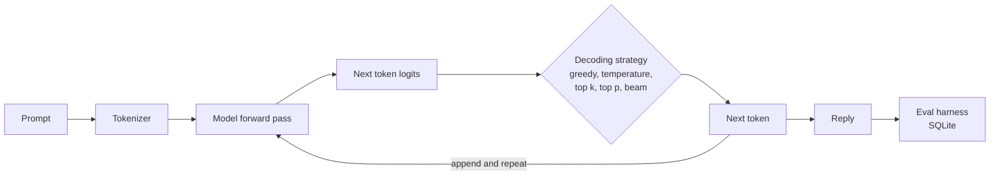
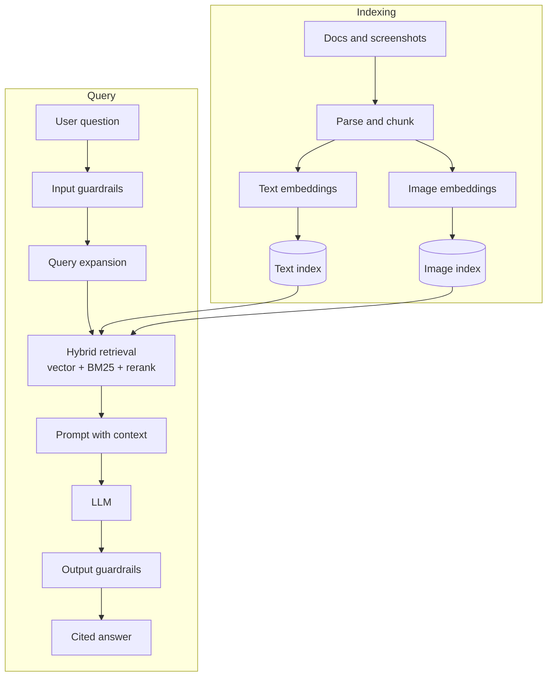
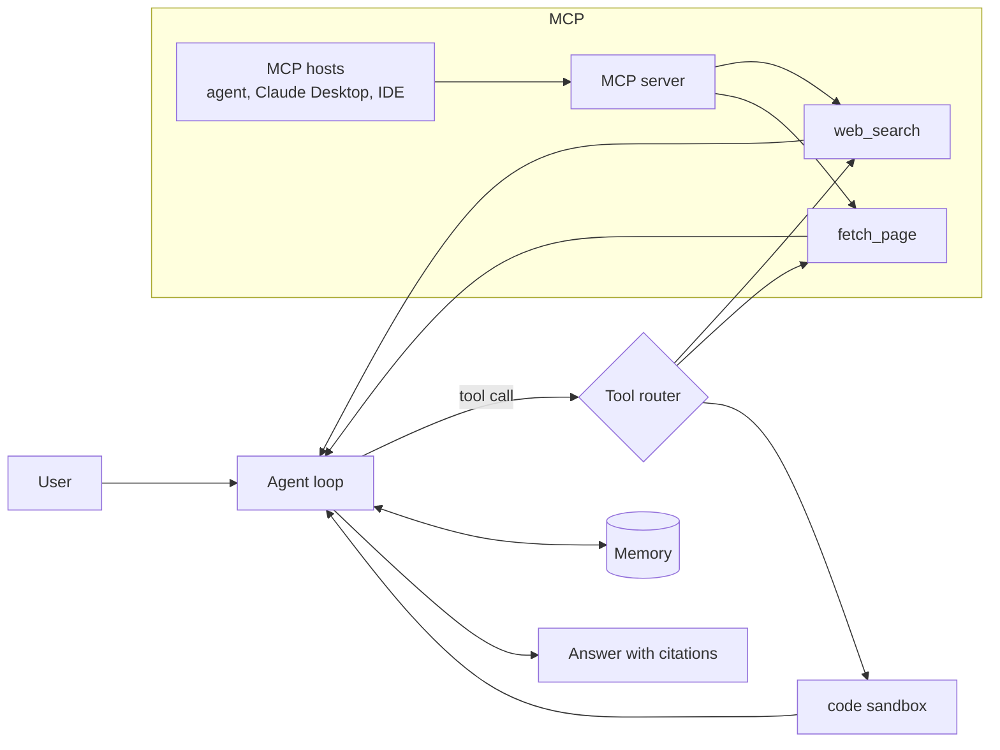
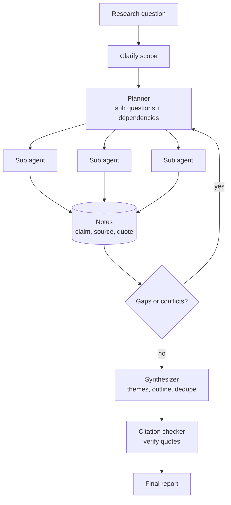

# Build Guide

Four projects that build on each other, from how a model picks a single token to a multi agent research system. The project ideas follow the four sessions of ByteByteGo's AI Engineering course. The designs, diagrams and code in this repo are original.

The rule throughout is simple. Write the core loop by hand first (decoding, retrieval, the agent loop, orchestration). Reach for a framework only after you know what it hides.

| # | Project | Focus |
|---|---|---|
| 1 | LLM Playground | Tokenization, decoding, sampling, model comparison, evaluation |
| 2 | Customer Support Chatbot | Multimodal RAG, hybrid retrieval, guardrails, LoRA |
| 3 | Ask the Web Agent | Tool calling, agent patterns, ReAct, MCP |
| 4 | Deep Research | Planning, parallel sub agents, synthesis, citations, reasoning models |

**Shared stack:** Python 3.12 with uv, Ollama for local models, Hugging Face transformers, Streamlit and FastAPI, plus one hosted API for comparison.

## 1. LLM Playground

Make the path from prompt to reply visible.

**Stack:** Ollama, transformers with Qwen2.5 0.5B, tiktoken, Streamlit, SQLite.

**Steps**

1. Run three or four local models from different families through Ollama.
2. Build a tokenizer explorer that shows tokens, IDs and token counts across tokenizers.
3. Write the decoding loop by hand: greedy, temperature, top k, top p and beam search. Chart the top ten next token probabilities at each step.
4. Build a chat UI with a model picker, decoding sliders, a system prompt and streaming.
5. Compare two to four models side by side on latency, tokens per second and token counts.
6. Add an eval harness of 20 to 30 prompts, scored by exact match and an LLM judge.
7. Run the same prompts on a base model and its instruct version.
8. Stretch: a small supervised fine tune with TRL.

**Done when** the UI and the eval numbers explain how sampling settings change the output.

## 2. Customer Support Chatbot

A support assistant that answers from real documentation, returns relevant screenshots, cites sources and refuses when the docs don't cover the question.

**Stack:** Docling, sentence transformers, CLIP or SigLIP, FAISS, rank_bm25, a cross encoder reranker, FastAPI, Streamlit.

**Steps**

1. Choose a public documentation set with screenshots, around 100 to 300 pages.
2. Compare three chunking strategies: fixed size, by heading and semantic.
3. Index text and images in separate FAISS indexes. Then compare flat and HNSW indexes.
4. Combine vector and BM25 results with reciprocal rank fusion, then rerank.
5. Add query expansion with rewrites or HyDE.
6. Write a prompt that cites chunk IDs and declines when context is missing.
7. Add input guardrails (PII, prompt injection, off topic) and output guardrails (grounding, citations).
8. Evaluate on 50 questions with recall at k, MRR, faithfulness and answer relevance.
9. Fine tune tone with LoRA, then try RAFT with distractor documents.

**Done when** the eval shows which chunking, retrieval and reranking setup wins, and unanswerable questions get a refusal.

## 3. Ask the Web Agent

An agent that searches the web, reads pages and answers with numbered citations. Its tools are also exposed over MCP.

**Stack:** Anthropic or OpenAI SDK with raw tool calling, a search API, trafilatura, the MCP Python SDK, Docker, Langfuse or OpenTelemetry.

**Steps**

1. Write the agent loop by hand with `web_search` and `fetch_page`.
2. Number sources and require inline citations.
3. Implement five workflow patterns: chaining, routing, parallelisation, reflection and orchestrator worker.
4. Build ReAct with a visible trace, then ReWOO. Compare cost and latency.
5. Add short and long term memory.
6. Add a sandboxed Python tool with no network and strict limits.
7. Serve the tools from an MCP server and use them from the agent and from Claude Desktop.
8. Stretch: expose the agent over A2A.
9. Evaluate 30 questions on accuracy, citation correctness, tool calls, latency and cost.

**Done when** the same tools work through MCP from more than one host, and the numbers show when ReAct beats ReWOO.

## 4. Deep Research

Takes a broad question, clarifies it, plans the work, runs sub agents in parallel and returns a structured, cited report.

**Stack:** a reasoning model (DeepSeek R1 locally, plus a hosted thinking model), the Project 3 agent, asyncio, Pydantic, Docker Compose.

**Steps**

1. Ask two or three clarifying questions before planning.
2. Produce a validated plan of sub questions with dependencies.
3. Run sub agents in parallel with tool and token budgets. Store findings as structured notes.
4. Loop back to the planner to fill gaps, up to a fixed depth.
5. Reuse the Project 3 sandbox for calculations.
6. Synthesise notes into themes, an outline and a draft.
7. Verify every quote against its source page and format references.
8. Compare best of N planning, self consistency, and reasoning versus standard models.
9. Run the full stack locally with Docker Compose and streamed progress.
10. Score ten research prompts on coverage, accuracy, citation precision and readability.

**Done when** every claim in a report has a verified citation and the rubric scores are recorded.
